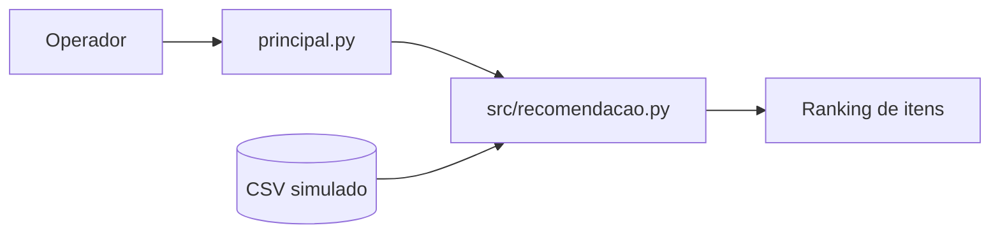

# Arquitetura — recomendador baseline

Sem serviços externos ou SDKs para o baseline. O serviço SVD original permanece em estudos, requer dependências e correções próprias. A regra de popularidade é apenas uma referência reprodutível e não um motor de IA generativa.
